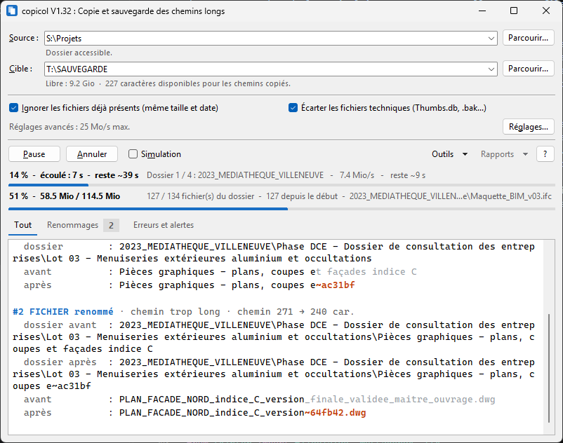

# copicol

**Chemins trop longs ? Vos fichiers méritent mieux qu'une erreur Windows.** Copiez vos dossiers depuis un NAS, un serveur ou un disque, même lorsque leurs chemins dépassent les limites de Windows. copicol raccourcit automatiquement les noms, conserve leur correspondance et permet de restaurer l'arborescence d'origine.




## Télécharger

👉 [**Dernière version**](../../releases/latest)

Aucune installation : téléchargez le fichier `.exe` et lancez-le, depuis le disque ou une clé USB. Windows 10 ou 11, sans droits d'administrateur.

## Version de démonstration

La démo fonctionne en simulation : elle parcourt vos dossiers et produit le rapport complet (fichiers à renommer, nom avant / après, erreurs), sans rien copier. L'estimation du volume et de la durée, la recherche dans une sauvegarde, sa vérification (face à la source ou à son manifeste SHA-256), son archivage en zip et la récupération des droits sont également libres. La copie, la reprise et la restauration demandent une licence : [plan-code.lemonsqueezy.com](https://plan-code.lemonsqueezy.com).

## Windows bloque copicol ?

Copicol n'est pas signé par un certificat de signature de code. Au premier lancement, Windows peut donc afficher un avertissement : cela signifie seulement que l'éditeur ou le programme n'est pas identifié, et ne dit rien de son contenu.

- **« Windows a protégé votre ordinateur »** (SmartScreen) : cliquer sur
  **Informations complémentaires**, puis **Exécuter quand même**. Windows ne
  le redemande plus pour ce fichier.
- **« Smart App Control a bloqué une application »** : ce contrôle de
  Windows 11 bloque les programmes non signés et n'offre pas de bouton pour
  passer outre. Il n'est actif que sur certains postes : voir **Sécurité
  Windows ▸ Contrôle des applications et du navigateur ▸ Paramètres de Smart
  App Control**. On peut l'y désactiver, mais c'est un choix de sécurité
  pour tout le poste (sur un poste d'entreprise, à voir avec le service
  informatique) : selon la version de Windows, il ne peut plus être réactivé
  ensuite sans réinstaller Windows. À défaut, utiliser copicol depuis un
  autre poste.

**Avant d'acheter une licence**, lancez une **simulation** sur le poste
prévu : elle est gratuite et montre que copicol y démarre et y lit vos
dossiers.

## Pourquoi

Les serveurs de projets accumulent des chemins de plus de 260 caractères.
L'explorateur Windows, Office ou un zip ne savent alors plus les ouvrir, et les
outils de copie classiques échouent en silence ou s'arrêtent. copicol lit ces
chemins sans difficulté, produit une copie dont **tous les chemins restent
sous une limite choisie** (240 caractères par défaut) et note, pour chaque
élément renommé, son nom d'origine et son nouveau nom.

## Installation

Aucune. Télécharger `copicol_x.xx.exe` (`x.xx` : le numéro de version,
par exemple `copicol_1.31.exe`) depuis la page
[Releases](../../releases) et le lancer : il
embarque tout ce qu'il lui faut et fonctionne depuis une clé USB, sans droits
d'administrateur. Windows 10 ou 11.

Si Windows bloque le premier lancement, voir « Windows bloque copicol »
ci-dessus.

Pour vérifier qu'un exécutable recopié n'a pas été altéré, comparer son
empreinte à celle du fichier `.sha256` publié à côté (par exemple
`copicol_1.31.exe.sha256`) :

```powershell
Get-FileHash copicol_1.31.exe -Algorithm SHA256
```

## Utilisation

1. **Source** : le dossier à sauvegarder. Il n'est jamais modifié.
2. **Cible** : un dossier **court** sur le disque externe (ex. `E:\SAUVEGARDE`) :
   chaque caractère pris par la cible manque aux chemins copiés. Sous le
   champ s'affichent la place libre et le nombre de caractères laissés aux
   chemins copiés ; un dossier introuvable y est signalé en rouge. Lancé
   depuis une clé USB ou un disque externe, copicol propose le bouton
   **Ce lecteur** (Alt+L) : la sauvegarde va dans `<lecteur>:\SAUVEGARDE`
   sur ce même support, créé au besoin. Ses chemins sont mémorisés sans la
   lettre : la clé branchée sous une autre lettre retrouve sa cible.
3. **Démarrer la copie** (ou Entrée). Le bouton reste grisé tant que les deux
   dossiers ne sont pas valides. Les chemins et options sont mémorisés, et
   la flèche des champs propose les derniers dossiers utilisés.

Pour voir à l'avance ce qui sera renommé, cocher **Simulation** : copicol
parcourt la source et produit les rapports sans rien écrire sur la cible. Un
bandeau orange le rappelle tant que la case est cochée.

**Estimer…**, à côté de Démarrer, mesure d'abord la source et ce que la cible
contient déjà, puis annonce le volume restant à copier, la place libre (en
alerte si elle manque) et la durée prévue, et demande confirmation avant de
lancer la copie (ou la simulation, si la case est cochée). Échap annule la
mesure. L'estimation est libre, sans licence. Une copie lancée ainsi affiche son
avancement d'ensemble en volume, avec le temps restant.

L'estimation est approchée : elle lit la liste des fichiers, pas leur contenu,
et déduit de la source tout ce que la cible contient déjà. La durée se fonde
sur le débit de la dernière copie d'au moins 30 secondes et 100 Mio : elle
reste inconnue avant cette première copie, et fausse si l'on change de
réseau ou de disque.

### Licence d'utilisation

La simulation et l'estimation sont libres : elles montrent, sur vos propres
dossiers, combien d'éléments seraient renommés, le volume à copier et la
durée prévue. La vérification d'une sauvegarde, la récupération des droits et
l'archivage en zip le sont aussi. La **copie**, la **reprise** et la
**restauration** demandent une licence. À la première copie, copicol demande
la clé reçue par e-mail après l'achat et l'active ; une connexion à Internet
est nécessaire à ce moment-là. Ensuite, si le poste est connecté, la clé
est revérifiée en arrière-plan au plus une fois par semaine ; hors ligne,
copicol fonctionne normalement pendant 30 jours. Au-delà, la copie et la
reprise attendent une revérification réussie : il suffit de brancher le poste
sur Internet une fois par mois. La restauration, elle, reste toujours
possible hors ligne. À l'activation, copicol envoie à Lemon Squeezy le nom du
poste et le numéro de série du support, pour que l'acheteur reconnaisse ses
activations.

La licence est liée au lecteur (disque ou clé USB) d'où `copicol_x.xx.exe` est
lancé, et chaque lecteur activé compte pour une activation. Pour l'emporter
de serveur en serveur, copier `copicol_x.xx.exe` sur une clé USB et l'activer
depuis la clé : il fonctionne ensuite sur tout ordinateur où on la branche.
Lancé depuis un partage réseau, chaque poste compte pour un lecteur.
La licence est enregistrée à côté de l'exécutable
(`copicol_licence.json`) : déplacer les deux fichiers ensemble dans un autre
dossier du même lecteur ne la perd pas. Recopiée sur un autre lecteur, ou
modifiée à la main, elle est refusée à la revérification suivante.

Pour utiliser la licence sur un autre lecteur ou ordinateur : bouton **?**, puis
**Licence…** et **Libérer**, puis activer la clé depuis le nouveau. Un lecteur
reformaté ou remplacé n'est plus reconnu : libérer son ancienne activation
depuis la page de commande Lemon Squeezy (lien dans l'e-mail d'achat), puis
réactiver la clé.

Au premier lancement, copicol affiche sa licence, à accepter pour
l'utiliser, ainsi que ce mode d'emploi et les licences des composants qu'il
embarque. Ce mode d'emploi s'ouvre ensuite à chaque démarrage, tant que la
case **Afficher ce mode d'emploi au démarrage** reste cochée ; le bouton **?**
le rouvre à tout moment. La fenêtre suit le thème clair ou sombre de Windows,
sauf à en imposer un par **Outils ▸ Thème** (Clair, Sombre ou Comme Windows).

### Pendant la copie

Les boutons **Pause** et **Annuler** prennent la place de Démarrer et
Estimer. L'avancement s'affiche aussi sur le bouton de copicol dans la barre
des tâches de Windows : on le suit fenêtre réduite.

- **Pause** suspend la copie (pour libérer le réseau en journée, par
  exemple) ; elle repart exactement où elle s'était arrêtée.
- **Annuler** (ou Échap) l'arrête ; le fichier en cours, incomplet, est
  effacé. Après une minute de copie, une confirmation est demandée.
- Fermer la fenêtre pendant une copie demande aussi confirmation.
- Le journal se filtre (**Renommages**, **Erreurs et alertes**) et se copie :
  sélection puis Ctrl+C, ou clic droit.

### À la fin de la copie

Un bandeau coloré résume le résultat (vert : tout est copié, orange : des
erreurs, rouge : copie interrompue) et reste affiché jusqu'à la copie
suivante. En cas d'erreur ou d'interruption, le bouton de la barre des
tâches reste rouge jusqu'à ce que le bandeau soit fermé. Le menu **Rapports** propose alors :

- **Rapport .txt** : synthèse, puis chaque renommage, erreur et élément
  ignoré ;
- **Rapport .csv** : la liste de tous les éléments traités, ancien et nouveau
  chemin, à filtrer dans Excel pour retrouver un fichier ;
- **Dossier des rapports** : `_RAPPORT_COPICOL` à la racine de la cible, où
  chaque copie ajoute ses rapports datés.

Le rapport signale aussi les éléments **présents dans la cible mais absents
de la source** : des fichiers supprimés ou renommés sur le serveur depuis une
copie précédente. copicol ne les efface jamais : à vous de juger s'ils
doivent rester dans la sauvegarde. S'ils avaient une empreinte, le contrôle
avec le manifeste les dira ensuite « manquants » une fois supprimés : c'est
attendu.

### Retrouver un fichier

**Outils ▸ Rechercher un fichier…** (Ctrl+F) ouvre une fenêtre de recherche dans les rapports de la
sauvegarde (la cible indiquée, ou une autre avec **Changer…**). Taper un ou
plusieurs mots du nom ou du chemin d'origine, dans n'importe quel ordre :
`plan rdc dwg`. La liste donne chaque fichier trouvé, son dossier d'origine
et la date de la copie. Un double-clic ouvre son emplacement dans la
sauvegarde, même s'il y a été raccourci ou déporté ; le clic droit copie son
chemin. Si la sauvegarde a changé de lettre de lecteur depuis la copie, les
chemins sont recalculés.

### Restaurer une sauvegarde

**Outils ▸ Restaurer une sauvegarde…** recopie une sauvegarde en rétablissant les **noms et
l'arborescence d'origine**, d'après tous ses rapports de copie :

1. Choisir la sauvegarde : le dossier cible d'une copie, qui contient
   `_RAPPORT_COPICOL`.
2. copicol propose de restaurer vers le dossier d'origine (**Restaurer vers
   ce dossier**), ou vers un autre (**Choisir un autre dossier…**).
3. La restauration se déroule comme une copie : progression, pause,
   annulation, bandeau de fin.

Aucun fichier déjà présent à l'arrivée n'est remplacé : identique, il est
sauté ; différent, il est conservé et listé dans le rapport. Restaurer vers
le serveur d'origine ne fait donc que recréer ce qui y manque. Le rapport de
restauration (`rapport_restauration_<date>`) est déposé dans
`_RAPPORT_COPICOL`, sur la sauvegarde : rien d'autre n'est écrit à l'arrivée.
Sans les rapports de copie, les noms d'origine ne peuvent pas être rétablis :
ne supprimez pas `_RAPPORT_COPICOL`.

### Vérifier une sauvegarde

**Outils ▸ Vérifier la sauvegarde (comparer à la source)…** (Alt+V) contrôle
la sauvegarde indiquée dans Cible **sans
rien recopier** : chaque fichier de la source est comparé, octet par octet, à
son double dans la cible, relu sur le disque lui-même. À la différence de
l'option « Vérifier chaque fichier après copie », qui relit chaque fichier
aussitôt écrit, elle se lance à tout moment, des mois après la copie : le
disque a-t-il gardé ce qu'on lui a confié ?

Sans la source, **Outils ▸ Contrôler avec le manifeste SHA-256…** prend le
relais (voir « Contrôler sans la source »).

Les noms de la sauvegarde sont recalculés avec la longueur maximale, la règle
de renommage et les exclusions de sa dernière copie, lues dans son rapport :
noms raccourcis et dossier de secours compris. La comparaison se fait au
dossier d'origine de la sauvegarde, lu lui aussi dans ce rapport, quelle que
soit la source affichée : rien à choisir. S'il est devenu inaccessible (serveur
renommé, disque déplacé), copicol propose de comparer à la source indiquée.

Chaque fichier reçoit un statut, dans le rapport `rapport_verification_<date>` :

| Statut | Sens |
|---|---|
| identique | Relu sur la sauvegarde, identique à la source. |
| altere | Même date que la source, contenu différent : la sauvegarde est abîmée. Contrôlez le disque, puis relancez la copie sans « Ignorer les fichiers déjà présents ». |
| manquant | Dans la source, pas dans la sauvegarde. |
| perime | Modifié dans la source depuis la copie, ou pendant la vérification : la prochaine copie le mettra à jour. |
| absent de la source | Dans la sauvegarde seulement (supprimé du serveur depuis). |

La vérification est libre, comme l'estimation : elle n'écrit que son rapport,
et le manifeste des fichiers trouvés identiques (voir ci-dessous).

### Contrôler sans la source

Une fois le serveur d'origine mis au rebut, **Vérifier la sauvegarde…** n'a plus rien à
quoi comparer. Pour ce moment-là, copicol garde l'**empreinte SHA-256** et la
**taille** de chaque fichier dont la copie a été validée :

- une copie avec « Créer un manifeste SHA-256 » (Réglages…, groupe Sécurité,
  cochée par défaut) note chaque fichier relu sur le disque et identique à la
  source, à partir des blocs déjà lus pour la copie : la source n'est pas
  relue. Cette option impose donc « Vérifier chaque fichier après copie » ;
- **Vérifier la sauvegarde…** note chaque fichier trouvé identique : une sauvegarde copiée
  sans vérification, ou avec une version antérieure de copicol, reçoit ainsi
  ses empreintes tant que la source existe.

Jamais une empreinte n'est prise sur un fichier simplement lu dans la source,
ni confirmée pour un fichier « déjà présent » d'après sa taille et sa date :
il garde celle de sa dernière validation, que le contrôle confronte à son
contenu réel.

Les empreintes sont rangées dans `_RAPPORT_COPICOL` :

| Fichier | Rôle |
|---|---|
| `empreintes.csv` | **Manifeste de la sauvegarde** : un fichier par ligne (`sha256;octets;chemin;valide_le`), UTF-8, à ouvrir dans Excel. Refait après chaque copie : les fichiers modifiés y prennent leur nouvelle empreinte, les nouveaux s'y ajoutent, ceux recopiés sans vérification en sortent. |
| `empreintes.sha256` | Le même, au format `sha256sum`, avec l'empreinte du CSV. Sans copicol, depuis le dossier de la sauvegarde : `sha256sum -c _RAPPORT_COPICOL/empreintes.sha256`. |
| `rapport_<copie ou verification>_<date>.empreintes` | **Journal** d'une copie, à côté de son rapport : la trace d'origine, écrite au fil de la copie et forcée sur le disque après chaque dossier. Le manifeste en est tiré. |

Les chemins sont relatifs à la sauvegarde, au nom réellement écrit sur le
disque (noms raccourcis et `_CHEMINS_TROP_LONGS` compris) : le disque peut
changer de lettre.

**Outils ▸ Contrôler avec le manifeste SHA-256…** relit ensuite la sauvegarde, des mois
après, sur n'importe quel poste, sans rien lire d'autre que ce disque. La
taille est comparée d'abord, puis chaque fichier est relu en entier sur le
disque lui-même et son empreinte recalculée. Rapport `rapport_controle_<date>`,
dans `_RAPPORT_COPICOL` :

| Statut | Sens |
|---|---|
| identique | Conforme à son empreinte : intact depuis la validation de sa copie. |
| altere | Taille ou contenu différent de la référence SHA-256. |
| manquant | Cité par les empreintes, absent du disque. Le bandeau, orange, demande s'il a été supprimé à la main (absent de la source) ; sinon, le reprendre d'une autre sauvegarde. |
| sans empreinte | Recopié sans vérification depuis sa dernière empreinte, ou copie coupée net pendant qu'il était remplacé : non contrôlé. « Vérifier la sauvegarde… » lui redonne une empreinte. |
| absent du manifeste | Sur le disque, cité par aucune empreinte (ajouté à la main, copié sans vérification) : signalé, jamais supprimé. |
| erreur | Lecture impossible sur le disque de sauvegarde. |

**Protection** : chaque fichier d'empreintes commence par une ligne de format
(`# format copicol-…`) et finit par un sceau, l'empreinte de tout ce qui
précède ; il passe ensuite en lecture seule. Un journal est écrit une fois,
jamais réécrit. Le manifeste est écrit sous un nom temporaire, relu et
validé, puis seulement mis à la place de l'ancien : une coupure laisse
l'ancien intact. Le contrôle signale, dans le bandeau et en tête du rapport,
un journal modifié, aux lignes illisibles, d'un format inconnu (ignoré) ou
sans sceau (copie coupée net), et un manifeste absent, abîmé ou en retard
sur les journaux ; il s'appuie alors sur les journaux, et la copie suivante
refait le manifeste. Le contrôle est libre.

### Archiver une sauvegarde

**Outils ▸ Archiver une sauvegarde en zip…** fait d'une sauvegarde terminée
un fichier `.zip`, pour l'envoyer ou la ranger. Choisir le dossier cible
d'une copie, puis l'emplacement de l'archive, **hors de la sauvegarde** (par
défaut à côté, nommée d'après le dossier et la date). Les chemins y sont déjà
raccourcis : le zip s'ouvre et s'extrait partout, explorateur compris.

- Les rapports `_RAPPORT_COPICOL` sont archivés avec la sauvegarde : une fois
  extraite, elle se restaure comme l'originale. Le point de reprise et le
  verrou d'une copie ne le sont pas.
- Les formats déjà compressés (PDF, images, vidéos, DWG, Revit, fichiers
  Office, zip…) sont rangés tels quels : les recompresser ne gagnerait rien
  et prendrait des heures. Les autres sont compressés.
- L'archive est écrite sous un nom provisoire (`.zip.partiel`), **relue en
  entier** (chaque fichier décompressé et contrôlé), puis renommée : un zip
  qui porte son nom final est toujours complet. Une archive du même nom est
  remplacée à ce moment-là seulement.
- Annuler (Échap) ou une erreur ne laisse aucune archive partielle.
- Si une copie écrit dans la sauvegarde (depuis ce poste ou un autre),
  l'archivage est refusé jusqu'à ce qu'elle se termine ; aucune copie ne
  peut y écrire tant qu'il dure.
- **Tout ou rien** : si un seul élément ne peut pas être lu (fichier
  verrouillé, dossier sans droits), l'archivage s'arrête sans rien écrire et
  nomme chaque élément en cause. Le libérer (fermer le logiciel qui le tient,
  récupérer les droits) puis relancer.

La sauvegarde n'est jamais modifiée. L'archivage est libre, sans licence.

### Reprendre une copie

**Après une interruption** (annulation, câble débranché, disque plein,
coupure de courant) : relancer avec la même source et la même cible.
copicol propose alors :

- **Reprendre la copie** : au premier sous-dossier non terminé ;
- **Tout recommencer** : depuis le début (les fichiers déjà présents et
  identiques ne sont pas recopiés si l'option est cochée).

**Depuis un rapport**, même des jours plus tard :

1. Menu **Outils ▸ Reprendre d'après un rapport…**, puis choisir le rapport (`.txt` ou `.csv`) de la
   copie concernée, dans `_RAPPORT_COPICOL`. La source et la cible sont
   remplies d'après le rapport.
2. Si le rapport contient des erreurs (fichier verrouillé, réseau coupé un
   instant…), copicol propose :
   - **Recopier les N élément(s)** : **seulement les éléments en erreur**,
     sans reparcourir toute la source ;
   - **Relancer la copie complète** : reprise au dossier interrompu.
3. La reprise produit un nouveau rapport. S'il reste des erreurs, le bandeau
   le dit : recommencer avec ce nouveau rapport.

Une erreur sur un dossier entier illisible de la source ne peut se reprendre
qu'en relançant la copie complète : copicol l'indique. Le rapport d'une
simulation remplit seulement la source et la cible, sans rien lancer.

### Options

| Option | Effet |
|---|---|
| Simulation | À côté du bouton Démarrer : produit les rapports sans rien copier. Jamais mémorisée. |
| Ignorer les fichiers déjà présents | Ne recopie pas un fichier de même taille **et** même date. Un fichier modifié depuis la dernière copie est remplacé. |
| Écarter les fichiers techniques | `Thumbs.db`, verrous Office, `.bak` et `.sv$` d'AutoCAD… comptés dans le rapport, jamais copiés. |

Dans la fenêtre **Réglages…** (Alt+G ; la fenêtre principale rappelle les
réglages modifiés). Pendant une copie, **Débit max.** et **Repos** changent
aussitôt, sans l'interrompre, et le journal le note ; les autres réglages de
copie sont grisés jusqu'à la fin, pour ne pas faire une moitié de la
sauvegarde d'une façon et l'autre d'une autre :

| Option | Effet |
|---|---|
| Longueur max. du chemin | Limite du chemin complet cible (240 par défaut, sous la limite Windows de 260). |
| Longueur max. d'un nom | Limite d'un nom de fichier ou de dossier (120 par défaut). |
| Raccourcir les noms | Règle appliquée à un nom trop long : coupe simple (par défaut), début et fin, ou abréviation. Voir [Règles de renommage](#règles-de-renommage). |
| Créer un manifeste SHA-256 | Cochée par défaut. Note l'empreinte de chaque fichier relu et validé, pour contrôler la sauvegarde même sans la source (voir « Contrôler sans la source »). Impose la vérification ci-dessous. Décochée, les empreintes déjà prises restent, et celles des fichiers recopiés depuis sont annulées. |
| Vérifier chaque fichier après copie | Relit la copie **sur le disque lui-même** (pas dans la mémoire de Windows) et la compare à la source. Plus lent : chaque fichier est relu une seconde fois. |
| Conserver (métadonnées) | **Date de modification seule** (par défaut, comme l'explorateur, avec l'attribut lecture seule) ; **Dates et attributs** : aussi la date de création et les attributs caché, système, archive, dossiers compris ; **Dates, attributs et permissions** : aussi les droits d'accès NTFS (la liste de contrôle d'accès, pas le propriétaire), pour une archive professionnelle. NTFS, exFAT, FAT32 et la plupart des NAS gardent dates et attributs ; seuls NTFS et certains NAS gardent les permissions. Une métadonnée que la cible ne connaît pas est abandonnée avec un seul avertissement au journal ; un refus ponctuel est compté dans le rapport et noté dans le CSV. Le fichier, lui, est toujours copié. Attention : les droits du serveur s'appliquent alors à la sauvegarde. Voir [Permissions et mode administrateur](#permissions-et-mode-administrateur). |
| Arrêter si le disque semble défaillant | Cochée par défaut. Après 5 erreurs matérielles d'affilée (lecture ou écriture impossible, erreur CRC, copie relue différente, disque débranché), la copie s'arrête au lieu d'user un disque peut-être mourant. Le journal dit quoi vérifier ; relancer reprend là où elle s'est arrêtée. Un simple accès refusé ne compte pas. |
| Débit max. | Plafonne la vitesse de copie pour ménager un disque ancien ou qui chauffe, ou laisser de la bande passante à un NAS encore utilisé en journée (choix 50 et 25 Mo/s) : de 100 Mo/s (léger frein) à 10 Mo/s (clé USB 2, disque fragile). Sans limite par défaut. |
| Repos | Après chaque heure de copie, laisse le disque refroidir de 5 à 30 minutes, puis reprend seule ; le journal l'annonce. Une pause manuelle ne compte pas dans l'heure, et Annuler interrompt le repos. Aucun par défaut. |
| Compresser la cible (NTFS) | Windows compresse chaque fichier écrit sur la sauvegarde, comme la case « Compresser » de l'explorateur : les fichiers restent lisibles tels quels, et reprise, vérification et restauration fonctionnent comme sans. Gain notable sur les textes, tableaux, IFC, bases et exports bruts ; presque nul sur les PDF, images, DWG et fichiers Office, déjà compressés. Disque NTFS seulement : sur exFAT, FAT32 ou un NAS, un avertissement au journal, et la copie se fait sans. Les fichiers déjà présents sur la sauvegarde ne sont compressés qu'à leur prochain remplacement (pour tout compresser d'un coup : `compact /c /s /i /q` dans le dossier de la sauvegarde). Jamais appliquée à une restauration. |
| Exclure | Fichiers et dossiers à ne pas copier, séparés par des points-virgules : `*.tmp; node_modules; ARCHIVES`. Jokers `*` et `?`, majuscules indifférentes. Un dossier exclu l'est avec tout son contenu. Chaque élément exclu est listé dans le CSV. |
| Afficher les infobulles | Cochée par défaut. Explication au survol de chaque élément de la fenêtre. |

### Permissions et mode administrateur

Avec « Dates, attributs et permissions », la sauvegarde reçoit les droits du
serveur : ils peuvent ne rien accorder à votre compte, et bloquer la copie
suivante ou l'ouverture des fichiers.

- **Lancé en administrateur** (clic droit sur copicol, « Exécuter en tant
  qu'administrateur »), copicol travaille comme `robocopy /B` : les
  permissions ne bloquent ni la lecture de la source ni l'écriture sur la
  sauvegarde, et le **propriétaire** de chaque fichier est recopié aussi. Le
  journal l'annonce en début de copie, et le rapport l'indique (« propriétaire
  compris »). Cela vaut aussi pour la vérification et la restauration.
- **Outils ▸ Récupérer les droits…** débloque une sauvegarde : votre compte
  reçoit l'accès complet à chaque élément, les autres permissions restent en
  place. Sans être administrateur, cela marche pour une sauvegarde faite sur ce
  PC avec votre compte, car vous en êtes propriétaire ; sur un autre PC, lancez
  copicol en administrateur, il reprend alors la propriété de chaque élément.

### Raccourcis clavier

| Touche | Action |
|---|---|
| Entrée | Démarrer la copie |
| Échap | Annuler la copie (confirmation demandée après une minute) |
| Ctrl+F | Rechercher un fichier dans une sauvegarde |
| Alt+S, Alt+C | Aller au champ Source, Cible |
| Alt+M, Alt+I | Cocher ou décocher Simulation, Ignorer les fichiers déjà présents |
| Alt+D, Alt+E | Démarrer, Estimer |
| Alt+V | Vérifier la sauvegarde (Outils ▸ Vérifier la sauvegarde) |
| Alt+G | Réglages avancés |
| Alt+L | Cible sur le lecteur de copicol (bouton « Ce lecteur », s'il est affiché) |
| Alt+P, Alt+R, Alt+A | Pause, Reprendre, Annuler |

### Règles de renommage

Chaque nom est d'abord nettoyé :

- caractères interdits (`< > : " / \ | ? *`) remplacés par `_` ;
- noms réservés (`CON`, `NUL`, `COM1`…) précédés de `_` ;
- points et espaces finaux retirés.

Puis, s'il ne tient pas dans la limite, il est raccourci en gardant son
extension, précédée d'un code stable (`~3fa2c1`) qui le rend unique. La
partie du nom conservée dépend de la règle choisie dans les options avancées.
Par exemple, ramené à 40 caractères :

```
Compte rendu de la réunion de chantier n°12 - indice B.pdf

Coupe simple   Compte rendu de la réunion de~3fa2c1.pdf
Début et fin   Compte rendu de...indice B~3fa2c1.pdf
Abréviation    Compte rendu réunion chantier~3fa2c1.pdf
```

- **Coupe simple** (par défaut) garde le début du nom.
- **Début et fin** garde aussi la fin, où figurent souvent l'indice, la
  version ou la date.
- **Abréviation** retire d'abord les mots vides (de, la, le, et, pour…),
  puis coupe ce qui dépasse encore.

Le code dépend du chemin d'origine : une seconde copie produit exactement les
mêmes noms, à condition de garder la même règle. Le rapport de chaque copie
note la règle utilisée ; si vous en choisissez une autre pour une cible déjà
copiée, copicol propose de garder l'ancienne. Sinon, les fichiers déjà
raccourcis seraient recopiés sous un nouveau nom, les anciens restant en
double, signalés comme absents de la source.

Un dossier garde toujours 45 caractères de marge pour ce qu'il contient : son
nom est raccourci dès que son chemin dépasserait 195 caractères (240 − 45),
même si son contenu tiendrait sans cela. Sans cette marge, un dossier au nom
très long ne laisserait plus de place à ses fichiers, qui seraient tous
déportés.

Un dossier trop profond pour qu'un nom raisonnable y tienne est
déporté dans `_CHEMINS_TROP_LONGS`, à la racine de la cible.

Le rapport indique pourquoi chaque élément a été raccourci :

| Raison | Situation |
|---|---|
| nom trop long | Le nom dépasse à lui seul la longueur max. d'un nom (120). |
| chemin trop long | Le nom est correct, mais le dossier est si profond que le chemin complet dépasserait la limite (240, ou 195 pour un dossier : voir plus haut). |
| nom trop long + chemin trop long | Les deux : le nom dépasse 120, et le dossier impose une coupe plus courte encore. |
| profondeur excessive | Même raccourci, aucun nom lisible ne tient : l'élément part dans `_CHEMINS_TROP_LONGS`. |

Chaque renommage, dans le journal comme dans le rapport, cite la mesure qui
l'a imposé et la limite en vigueur pendant la copie, par exemple
`nom trop long : 126 car. pour 120 autorisés → 120` ou
`caractères interdits : « ? », remplacés par « _ »`. Le CSV la reprend dans
sa colonne `explication`.

### Ce que copicol écrit dans la cible

| Élément | Rôle |
|---|---|
| `_RAPPORT_COPICOL\rapport_copie_<date>.txt` | Rapport lisible : synthèse, renommages, erreurs, éléments ignorés. |
| `_RAPPORT_COPICOL\rapport_copie_<date>.csv` | Inventaire exhaustif (ancien et nouveau chemin), à ouvrir dans Excel. |
| `_RAPPORT_COPICOL\copie_en_cours.lock` | Présent pendant une copie : empêche deux copies simultanées vers la même cible. |
| `_RAPPORT_COPICOL\rapport_restauration_<date>.*` | Rapports des restaurations faites depuis cette sauvegarde. |
| `_RAPPORT_COPICOL\rapport_verification_<date>.*` | Rapports des vérifications de cette sauvegarde. |
| `_RAPPORT_COPICOL\empreintes.csv`, `empreintes.sha256` | Manifeste d'empreintes SHA-256 de la sauvegarde, scellé et en lecture seule : le contrôle sans la source s'en sert (voir « Contrôler sans la source »). |
| `_RAPPORT_COPICOL\rapport_<copie ou verification>_<date>.empreintes` | Journal d'empreintes de chaque copie, dont le manifeste est tiré. |
| `_RAPPORT_COPICOL\rapport_controle_<date>.*` | Rapports des contrôles sans la source. |
| `_CHEMINS_TROP_LONGS\` | Éléments trop profonds, si besoin. |
| `LISEZMOI_COPICOL.txt` | Explique la sauvegarde à qui branche le disque sans connaître copicol : noms raccourcis, rapports, restauration. |
| `copicol_etat.json` | Point de reprise d'une copie interrompue ; supprimé en fin de copie réussie. |

Un élément de la source qui porterait l'un de ces noms, à la racine, est
renommé pour ne pas les écraser.

## Sûreté de la copie

- **Reprise** : la copie avance sous-dossier par sous-dossier et se reprend
  au premier sous-dossier non terminé, ou seulement sur les éléments en
  erreur depuis un rapport (voir « Reprendre une copie »).
- **Jamais de fichier tronqué** : chaque fichier est écrit sous un nom
  temporaire, puis renommé une fois complet. Après une coupure brutale, la
  version précédente éventuelle reste intacte.
- **Disque plein** : la copie s'arrête net, avec un message clair, au lieu
  d'empiler une erreur par fichier restant.
- **Contrôle dans la durée** : **Vérifier la sauvegarde…** relit à tout moment la
  sauvegarde et la compare à la source, octet par octet (voir « Vérifier une
  sauvegarde ») ; sans la source, **Outils ▸ Contrôler avec le manifeste
  SHA-256…** la compare aux empreintes prises à la validation de chaque copie.
- **Veille** : Windows ne se met pas en veille pendant une copie (l'écran peut
  s'éteindre).
- **Liens symboliques et jonctions** : ignorés et signalés, pour éviter les
  boucles infinies.

## En cas de problème

Le bouton **?** (onglet « À propos ») indique la version et l'emplacement du
journal technique :

```
%LOCALAPPDATA%\copicol\copicol.log
```

Il contient le déroulé de chaque copie (options, synthèse) et le détail de
toute erreur imprévue. Le joindre à un signalement, avec le rapport `.txt` de
la copie concernée.

## Limites

Ce que copicol ne fait pas, ou fait seulement en partie, à connaître avant de
compter sur une sauvegarde.

copicol est un outil de copie, de récupération et d'archivage de fichiers. Ce
n'est ni une sauvegarde système, ni une sauvegarde à chaud des applications
(bases de données, messagerie…), ni une synchronisation permanente.

### Copie

- **Fichiers modifiés** : un fichier déjà présent n'est recopié que si sa
  taille ou sa date de modification a changé (à 2 secondes près, une heure
  d'écart tolérée pour le changement d'heure des disques FAT32). Un fichier
  modifié sans changer ni l'une ni l'autre n'est pas recopié : décocher
  « Ignorer les fichiers déjà présents » pour tout recopier.
- **Fichiers ouverts** : un fichier qu'un autre programme garde verrouillé
  (base de données, logiciel métier…) peut être refusé à la lecture. Il est
  alors signalé en erreur et se reprend avec **Outils ▸ Reprendre d'après
  un rapport…**.
- **Pas de cliché instantané (VSS)** : un fichier enregistré pendant sa
  copie est signalé en erreur (taille ou date changée en cours de lecture)
  et repris à la copie suivante. Mais un programme qui écrit dans un fichier
  sans en changer ni la taille ni la date (certaines bases de données) peut
  le laisser copié dans un état incohérent, sans erreur. Fermer les
  applications concernées, ou arrêter leurs services, avant de sauvegarder
  leurs données.
- **Propriétés des fichiers** : par défaut, seuls le contenu, la date de
  modification et l'attribut lecture seule sont conservés. L'option
  « Conserver » (Réglages…) ajoute la date de création, les attributs caché,
  système et archive, puis les permissions NTFS, et le propriétaire en mode
  administrateur. Jamais conservés : la date de modification des dossiers
  (ils prennent celle de la copie), le groupe principal et l'audit (SACL),
  les flux de données alternatifs, la compression et le chiffrement NTFS de
  la source (la sauvegarde peut être compressée : option « Compresser la
  cible »).
- **Permissions sur un NAS ou un disque exFAT/FAT32** : exFAT et FAT32 n'en
  ont pas ; un NAS les traduit à sa façon, ou les refuse. copicol le signale
  une fois au journal et copie quand même. Le mode administrateur n'a été
  éprouvé que sur des disques NTFS locaux.
- **Liens symboliques et jonctions** : ignorés et signalés, jamais suivis. Le
  dossier vers lequel ils pointent n'est pas copié par ce biais. Un lien
  posé dans la cible, à la place d'un fichier ou d'un dossier copié, est
  remplacé par la vraie copie : la copie n'écrit jamais ailleurs à travers
  lui. La restauration, elle, garde les jonctions du dossier où elle écrit
  (un dossier du serveur déplacé sur un autre volume, par exemple) et
  restaure à travers elles.
- **Relecture sur le disque** : la vérification relit chaque copie sur le
  disque lui-même, sans la mémoire de Windows. Si le système de fichiers
  refuse ce mode (certains partages réseau), la relecture passe par la
  mémoire de Windows, ce qui prouve moins ce que le disque a enregistré : le
  journal l'annonce une fois.
- **Exclusions** : un motif porte sur le nom seul, partout dans la source. On
  ne peut pas exclure un dossier `ARCHIVES` à un endroit précis et le garder
  ailleurs.
- **Absents de la source** : jamais effacés de la cible, qui grossit donc au
  fil des copies. Les supprimer à la main d'après le rapport.
- **Reprise** : les dossiers déjà terminés ne sont pas reparcourus. Ce qui y
  a changé depuis l'interruption (fichiers modifiés, ajoutés ou supprimés
  dans la source) passe donc inaperçu. Après une longue interruption, ou si
  la source a continué d'évoluer, faire une copie complète de contrôle
  (répondre **Non** à la proposition de reprise).
- **Abréviation** : elle ne retire que des mots vides courants, français et
  anglais (de, la, le, et, pour, the, of…). Elle ne forme pas de sigles et
  ne raccourcit pas les mots eux-mêmes : un nom sans mot vide est coupé comme
  avec la coupe simple.
- **Rapport .txt** : au-delà de 50 000 anomalies (renommages, erreurs…), il
  ne les détaille plus. Le `.csv` reste toujours exhaustif.

### Restauration

- **Rapports indispensables** : sans `_RAPPORT_COPICOL`, il est impossible de
  rétablir les noms d'origine. Les fichiers copiés restent lisibles et
  récupérables à la main, mais « Restaurer » ne les rend que sous leur nom
  raccourci, et ceux du dossier de secours sous leur code (`3fa2c1d4….dwg`)
  dans un dossier `_CHEMINS_TROP_LONGS`.
- **Limites de longueur ou règle de renommage changées** entre deux copies
  (malgré l'avertissement, pour la règle) : un même fichier peut
  figurer dans la sauvegarde sous deux noms raccourcis. Les deux reviennent
  au même nom d'origine : le second est sauté s'il est identique, conservé et
  signalé sinon.
- **Chemins longs** : la restauration rétablit les chemins d'origine, même
  au-delà de 260 caractères. L'explorateur, Office ou un zip peuvent de
  nouveau refuser de les ouvrir, comme sur le serveur d'origine.
- **Propriétés** : les mêmes que pour la copie, selon l'option « Conserver »
  choisie au moment de restaurer : elles sont reprises de la sauvegarde, donc
  seulement si la copie les y avait gardées. Les dates des dossiers ne sont
  pas rétablies.

### Vérification

- **Portée** : une vérification réussie garantit que les contenus comparés
  sont identiques au moment du contrôle. Elle ne garantit ni que les fichiers
  copiés sont cohérents pour leurs applications (voir « Pas de cliché
  instantané »), ni que les propriétés non prises en charge sont conservées.
- **Contenu seulement** : elle compare le contenu et la date de
  modification, pas la date de création, les attributs ni les permissions.
- **Réglages de la dernière copie** : si les limites de longueur ou la règle
  ont changé entre deux copies, les fichiers copiés sous les anciens noms
  sont signalés « absent de la source », et leur nouveau nom « manquant ».
- **Fichier modifié sans changer de date** dans la source (rare, mais
  certains logiciels le font) : il est signalé « altéré » alors que la
  sauvegarde est seulement en retard.
- **Durée** : chaque fichier est relu en entier des deux côtés, comme une
  copie complète sans écriture.

### Contrôle sans la source

- **Ce qu'il prouve** : qu'un fichier n'a pas changé depuis la validation de
  sa copie. Pas qu'il était juste à ce moment-là au-delà de cette validation
  (voir « Vérification »), ni que les propriétés sont conservées.
- **Fichiers sans empreinte** : ceux copiés sans vérification ne sont pas
  contrôlés, et le bandeau le dit. Tant que la source existe, lancez
  **Vérifier la sauvegarde…** une fois : c'est lui qui leur donne une empreinte.
- **Fichier modifié à la main** sur la sauvegarde : il est signalé « altéré ».
  **Supprimé à la main** (par exemple un élément absent de la source) : il
  reste « manquant » à chaque contrôle, en orange.
- **Empreintes perdues** : le manifeste effacé est refait par la copie
  suivante d'après les journaux ; un journal effacé emporte ses empreintes,
  et ses fichiers passent « absent du manifeste ». Une archive zip de la sauvegarde
  emporte les manifestes avec elle.
- **Lecture seule** : supprimer la sauvegarde peut demander une confirmation
  pour ses manifestes ; c'est voulu.
- **Durée** : chaque fichier est relu en entier, une seule fois.

### Archivage

- **Place** : l'archive se crée à côté de la sauvegarde, sur le même disque
  en général ; il faut donc jusqu'à son volume en place libre. Un disque
  plein arrête l'archivage, sans rien laisser.
- **Fichier verrouillé ou illisible**, dossier sans droits : l'archivage
  s'arrête, aucune archive n'est écrite, et chaque élément en cause est listé
  au journal. Une archive sans eux porterait le nom d'une sauvegarde entière.
  Les dossiers illisibles sont repérés dès la liste, avant toute écriture ;
  un fichier verrouillé, seulement quand vient son tour. Une erreur **en
  pleine lecture** (disque défaillant) arrête tout de même.
- **Durée** : l'archive est relue en entier après écriture ; compter le
  temps de deux lectures complètes de la sauvegarde.
- **Pas de découpage** en volumes, ni de mot de passe : pour une clé
  formatée en FAT32, une archive de plus de 4 Go ne passe pas.
- **Noms** : un nom au caractère Unicode incomplet (rare, admis par
  Windows) ne s'écrit pas dans un zip : l'élément est listé et l'archivage
  s'arrête ; le renommer, puis relancer.

### Recherche

- Elle lit les rapports, pas le disque : un fichier déplacé ou effacé à la
  main dans la sauvegarde depuis la copie est encore trouvé, mais son
  emplacement n'existe plus (copicol le signale).
- Un fichier présent dans plusieurs rapports est donné d'après le plus
  récent. La liste s'arrête à 500 résultats : préciser la recherche.

## Licence

copicol est un logiciel propriétaire © 2026 plan</>code, tous droits réservés. Son contrat de licence s'affiche au premier lancement.
